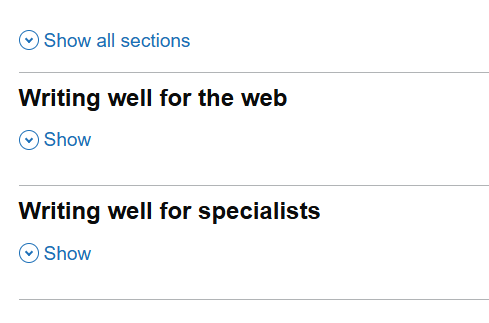
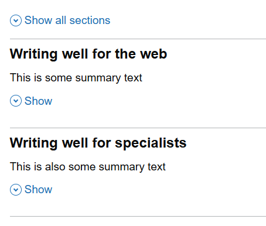
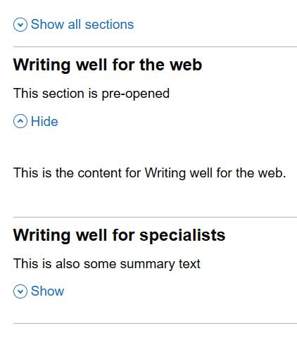

# Accordion

Render GOV.UK Design System styled accordion.

## Example image


## How it works

- renders a `<div class="govuk-accordion"` element styled according to the GOV.UK Design System.
- the `Id` parameter is required, and is used to uniquely identify the accordion sections, headers, and content.

## How the accordion sections work

- each section is defined using the `GdsAccordionSection` component
- `SectionTitle` parameter on `GdsAccordionSection` is required and is used to set the section header text
- optional `SummaryText` parameter for summary text underneath the title
- optional `IsExpanded` parameter sets the initial expanded state only; later changes are ignored because GOV.UK JavaScript manages the expanded state and accessible controls
- section CSS classes (including `AdditionalCssClasses`) are captured at initialization to avoid overwriting JavaScript-managed state
- optional `HeadingLevel` parameter to set the heading level for the section title (default is 2)
- `Content` child element is required and is used to define the content for the section
- the header ID and content ID are automatically generated

## Basic example



```razor
<GdsAccordion Id="accordion-test">
    <GdsAccordionSection Title="Writing well for the web">
        <Content>
            <p class="govuk-body">This is the content for Writing well for the web.</p>
        </Content>
    </GdsAccordionSection>
    <GdsAccordionSection Title="Writing well for specialists">
        <Content>
            <p class="govuk-body">This is the content for Writing well for specialists.</p>
        </Content>
    </GdsAccordionSection>
</GdsAccordion>
```

## Basic exmaple with summary text



```razor
<GdsAccordion Id="accordion-test">
    <GdsAccordionSection Title="Writing well for the web" SummaryText="This is the summary text for Writing well for the web.">
        <Content>
            <p class="govuk-body">This is the content for Writing well for the web.</p>
        </Content>
    </GdsAccordionSection>
    <GdsAccordionSection Title="Writing well for specialists" SummaryText="This is the summary text for Writing well for specialists.">
        <Content>
            <p class="govuk-body">This is the content for Writing well for specialists.</p>
        </Content>
    </GdsAccordionSection>
</GdsAccordion>
```

## Pre expanded example



```razor
<GdsAccordion Id="accordion-test">
    <GdsAccordionSection Title="Writing well for the web" SummaryText="This is the summary text for Writing well for the web." IsExpanded="true">
        <Content>
            <p class="govuk-body">This is the content for Writing well for the web.</p>
        </Content>
    </GdsAccordionSection>
    <GdsAccordionSection Title="Writing well for specialists" SummaryText="This is the summary text for Writing well for specialists.">
        <Content>
            <p class="govuk-body">This is the content for Writing well for specialists.</p>
        </Content>
    </GdsAccordionSection>
</GdsAccordion>
